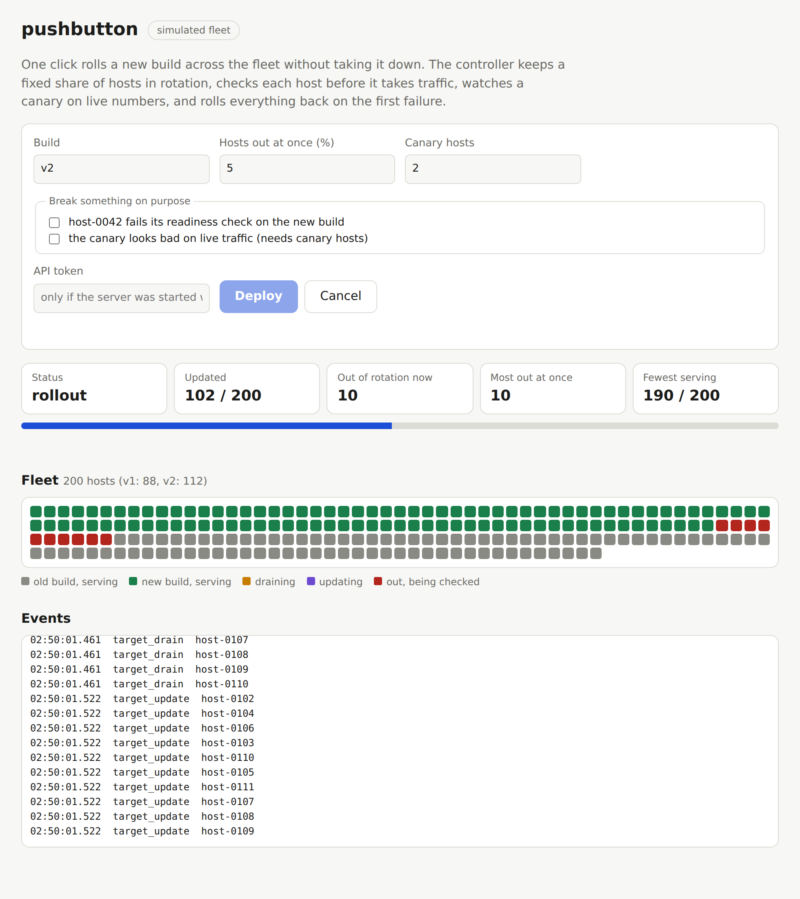

# webscale-edge-lab

The same load-balancing situations run through real HAProxy and Envoy processes in front of small Go backends that can crash, return errors, slow down, fail their health check or be replaced. Clients are real HTTP requests; every number is measured.

**Live demo:** https://gerardrecinto.github.io/webscale-edge-lab/ shows the recorded results side by side: failover, rolling deploy under load, a backend that fails requests but passes health checks, overload shedding, per-client rate limiting and consistent hashing.

**Also in this repo:** a push-button deploy controller (`deploy/`, `cmd/pushbutton`) that rolls a build across a fleet with a hard cap on hosts out of rotation, a canary judged on live numbers and automatic rollback, tested against real HAProxy, Nginx and Apache under load; a CVE and header gate (`secgate/`); a Splunk event sender (`splunk/`); and a `/proc` based host diagnosis tool (`hostdoctor/`). See "Push-button deploys" below.

Personal learning project: loopback only, one machine, HAProxy 3.4.4 and Envoy 1.38.3 locally (HAProxy from apt and Envoy 1.31 from the official image in CI). No VIPs, no real network, no production traffic.

## Scenarios (`go test ./... -v`)

| Scenario | What is asserted |
|---|---|
| Even spread | 3 backends, round robin, within 10% of even, no errors, on both proxies |
| Backend crash | a crashed backend is routed around with at most 5 client errors (connect retries hide it), and the restarted backend rejoins within 3 s |
| Backend returns 503, health check still 200 | plain HAProxy keeps sending it a third of the traffic; HAProxy with `observe layer7` and Envoy outlier detection both cut the error rate below 25% |
| Failing health check | traffic stops reaching the target within 1.5 s with zero client errors |
| Overload | with a per-backend cap, excess load is shed with 503 and accepted requests keep a bounded p95 |
| Per-client rate limit (HAProxy stick table) | a noisy client is mostly answered 429; a quiet client sees no failures |
| Rolling deploy | all three backends drained, stopped and replaced one at a time under constant load: zero failed requests, on both proxies |
| Consistent hashing | the same user always reaches the same backend; removing a backend moves 0% of unaffected users with consistent hashing and about half with the default map-based hash |

Tests skip a proxy if its binary is not on `PATH`.

## What I ran into

- **Envoy `max_ejection_percent` defaults to 10%.** With three backends that rounds to none: outlier detection counted 33 detected ejections and enforced 0 (`ejections_overflow` went up). The broken backend kept serving 503s to a third of requests until I set the percentage to 50.
- **Envoy's health checks ran far less often than configured.** The admin stats showed 3 successful checks in 4 seconds against a 0.3 s interval. I believe the 60 s default `no_traffic_interval` was applying because the proxy-to-backend connections were kept alive and no new connections were being opened. A crashed backend was never marked unhealthy and stayed in rotation, hidden by connect-failure retries. Setting `no_traffic_interval` to the check interval fixed it (42 checks in the same window). I did not read Envoy's source to confirm the cause, only observed the fix.
- **HAProxy has no passive checking by default.** The same 503-returning backend kept a third of the traffic (33% errors) until `observe layer7 error-limit 3 on-error mark-down` was added (7%). Neither HAProxy nor Envoy reaches zero: after ejection both let the server back and need to see errors again.
- **Overload behaves differently.** HAProxy queues for a free slot and answers 503 after the queue timeout (about 300 ms). Envoy's circuit breaker answers 503 within a few milliseconds and shed far more requests for the same offered load, because I set `max_pending_requests` to 1. The two configurations are not equivalent, so read that row as a contrast in style and not as a ranking.
- **Envoy's ring hash is not perfectly stable.** Removing a backend rebuilds the ring over the remaining hosts, and about 19% of users who were not on the removed backend moved. HAProxy's consistent hash moved none; HAProxy's default map-based hash moved 49%.
- Envoy runs with `--concurrency 1`, because each worker thread balances independently and round robin would otherwise be approximate.

## Regional failover drill (lab model, not production)

A second part of the lab models active-passive failover between two regions, as loopback HTTP servers in one process. Replication is async and lagged on purpose, so the data loss is real and measurable.

What is in `failover/`:

- **Fencing epoch + lease.** Each failover takes a new epoch from a fence store. The old primary only accepts writes while the orchestrator keeps renewing its lease, so if the fence call cannot reach it, the orchestrator waits out the lease before promoting. Writes with a stale epoch get 409.
- **Quorum of probers.** 3 probers, each needs 3 consecutive failures, 2 of 3 must agree. One blind prober does not trigger a failover (tested).
- **Replication lag gate (RPO).** The replica must be within `MaxLagOps` writes of the highest sequence any prober saw, otherwise failover is refused until an operator sets force.
- **Client circuit breaker.** Opens after 3 consecutive failures, half-open probe after 100 ms.
- **Chaos.** Per-region injected delay, 503 rate and dropped traffic from a named caller (used to partition the orchestrator from a primary the clients can still reach).

Run it (`go run ./cmd/failover-drill`, about 12 s, output from my laptop):

```
== crash
   +   119ms quorum says primary down
   +   120ms epoch 2 issued
   +   120ms fence unreachable, waiting 199ms for the lease to lapse
   +   320ms promoted us-east-1 at epoch 2
   writes acked 240, client errors 65, breaker rejected calls: true
   detect 119ms  RTO 330ms  lost writes 9 (RPO window 39ms)  stale writes accepted after promote 0  lag gate hit: false

== partition
   +   120ms quorum says primary down
   +   120ms epoch 2 issued
   +   220ms fence unreachable, waiting 61ms for the lease to lapse
   +   282ms promoted us-east-1 at epoch 2
   writes acked 293, client errors 23, breaker rejected calls: true
   detect 120ms  RTO 380ms  lost writes 0 (RPO window 0ms)  stale writes accepted after promote 0  lag gate hit: false

== laggate
   +    80ms quorum says primary down
   +    80ms failover refused: replica 151 writes behind, budget 20
   +   600ms epoch 2 issued
   +   600ms fence unreachable, lease already lapsed
   +   601ms promoted us-east-1 at epoch 2
   writes acked 241, client errors 128, breaker rejected calls: true
   detect 80ms  RTO 639ms  lost writes 159 (RPO window 794ms)  stale writes accepted after promote 0  lag gate hit: true
```

How to read it: RTO is measured from the fault to the first write acknowledged by the new primary. In the crash run, about 200 ms of the 330 ms is the lease wait, which is the price of not being able to tell a dead primary from an unreachable one. The lost-write window in the crash run (39 ms) matches the 40 ms replication delay I configured, and the lag gate run lost 159 writes because the replica was 1.5 s behind and I forced the failover. Numbers shift a little between runs.

Tests: `go test -race ./failover` covers the breaker states, stale-epoch and expired-lease rejection, the quorum, the gate (refuses, then force overrides) and the crash and partition drills.

What I ran into:

- **A slow lease renewal delayed failure detection.** My first version renewed the lease in the same loop as the probes. In the partition run the renewal hung for its whole 100 ms timeout on every tick, and detection took 341 ms instead of about 120 ms. Renewing in its own goroutine fixed it.
- **The lag figure is a lower bound.** Once the primary is dead nobody can ask it for its sequence, so the gate uses the highest sequence a prober saw before the fault. Writes acknowledged between the last probe and the crash are not counted, so the real loss can be higher than the gate believed.
- **Fencing needs a path to the old primary or a lease.** Fencing by epoch only works if the old primary learns the epoch. The lease is what covers the case where it cannot be reached, and it costs RTO.

Not covered: a real fence store outside both regions (it is a mutex here), failback, more than two regions, real network behavior, and real cross-region replication services.

## Push-button deploys

`deploy/` is a controller that rolls a build across many hosts without taking the service down. It does not care which load balancer is in front: a `Target` is one host that can be drained, updated, verified and put back.

The rules it enforces, each with a test:

| Rule | How it is tested |
|---|---|
| At most N hosts out of rotation at once | 1000 simulated hosts, batch 50: the controller's own counter and the simulator's independent count of serving hosts both stay inside the limit |
| A host is only put back after the new build passes its own readiness check, checked directly and not through the balancer | a build that fails every request is rolled out to real HAProxy under load: zero client requests fail and it never answers one |
| The first failure stops the rollout and restores every touched host, failed ones first | host 437 of 1000 fails verification: all 1000 end on the old build, still inside the batch limit |
| A canary has to look as good as the old build on live traffic, and fails closed without enough traffic | a build that passes `/healthz` but fails every third request: caught on one instance, 2.3% of requests failed in total, none after the rollback |
| A rollback that cannot finish is reported, not hidden | `rollback_failed` status and exit code 3 |
| Re-running after a cancel resumes, and finishes hosts that were updated but never put back | abort at host 30 of 100, run again, all 100 serving the new build |

### Measured against real proxies

Real HAProxy 2.8, Nginx 1.24 and Apache 2.4 in front of 6 instances (each takes 700 ms to start), 200 requests per second from clients for the whole deploy, no more than 2 instances out at once. Recorded by `cmd/record-deploy`, results in `docs/data.json` and on the Pages viewer.

| Proxy | How an instance leaves rotation | Deploy time | Requests | Failed |
|---|---|---|---|---|
| HAProxy | runtime API: `set server be/NAME state drain`, wait for the session count to reach 0 | 3.8 s | 1152 | 0 |
| Nginx | server written as `down`, graceful reload (SIGHUP), wait for old workers to exit | 3.5 s | 1088 | 0 |
| Apache | member written as `status=+D`, graceful restart (SIGUSR1) | 5.9 s | 1568 | 0 |

Requests were answered by both builds during every deploy (for example 554 from v1 and 598 from v2 on HAProxy), so the traffic really did span the swap. Four real JVMs (`java-app/`, built with Gradle) were also replaced behind HAProxy: 364 requests, 0 failed, each JVM drained on SIGTERM and exited before its replacement started.

### On a simulated fleet

`pushbutton demo` runs the same controller on 1000 in-memory hosts: 5% batches finish in about 100 ms with never more than 50 out and never fewer than 950 serving. `pushbutton serve` puts a REST API and a web page over a fleet of 200 (screenshot below, taken in the middle of a rollout with a 2 host canary). The API takes an optional bearer token for writes, keeps one deployment running at a time, validates every field, and serves the page under a CSP that allows no inline script.



### Real fleets

`pushbutton deploy -fleet fleet.json -version v2 -batch 5 -canary 2` drives real hosts through shell commands you give it, with `{{.Host}}` and `{{.Version}}` filled in: ssh and systemctl, a curl to a balancer API, anything. See `examples/fleet.ssh.json`. It reads every host's state first (16 at a time by default), refuses hostnames or versions that are not plain identifiers so a bad inventory line cannot inject shell, supports `-dry-run`, writes a JSON report, and exits 0 done, 1 rolled back, 3 rollback failed, 4 cancelled. A canary reads its numbers from an `observeCommand` that prints JSON, so it can be a Splunk or Prometheus query.

### The rest of the toolkit

- `secgate/`, `cmd/secgate`: reads a Trivy JSON report, fails the pipeline above a severity threshold, only for findings that have a fix if you want, with waivers that need a reason and an expiry (an expired waiver blocks again). `secgate headers URL` checks a running service against the OWASP Secure Headers Project list: HSTS, CSP, frame protection, nosniff, referrer and permissions policy, and leaked framework or server versions. The lab backend, the pushbutton service and the Java app all pass it.
- `splunk/`: sends deploy events to a Splunk HTTP Event Collector in batches, retries 5xx and network errors with backoff, does not retry a bad token, never blocks the deploy on Splunk. `splunk/searches.md` has the searches I would build on those events.
- `hostdoctor/`, `cmd/hostdoctor`: reads `/proc` and says what is wrong and what to run next: CLOSE_WAIT leaks, TIME_WAIT against the ephemeral port range, accept queues that are filling, ListenDrops, conntrack table pressure, file descriptors, inodes (the "df looks fine but writes fail" case), memory, load and pressure stall information. The accept-queue reading is checked against a real listener that never calls `accept()`.
- `java-app/`: a small JVM service with `/healthz`, an in-flight gauge and a SIGTERM shutdown hook that stops reporting ready, finishes its requests and exits. Built and tested with Gradle (`gradle -p java-app build`).
- `Jenkinsfile`: Gradle and Go builds in parallel, Trivy and the gate, a dry run of the rollout, then an approved rollout with a canary. Not run on a Jenkins server.
- `infra/alicloud/`: an internal SLB with connection draining in front of ECS instances. Written from the provider docs, not validated or applied (see below).

Run it:

```
go run ./cmd/pushbutton demo                          # 1000 simulated hosts
go run ./cmd/pushbutton demo -fail host-0437          # one host fails readiness, watch the rollback
go run ./cmd/pushbutton live -proxy nginx             # real Nginx, real traffic during the deploy
go run ./cmd/pushbutton live -proxy haproxy -canary 1 -version v3-flaky
go run ./cmd/pushbutton serve                         # http://127.0.0.1:8090
go run ./cmd/hostdoctor
go test -race ./...                                   # proxy and JVM tests skip when the binaries are not installed
```

### What I ran into

- **A swap with no startup time proves nothing.** My first HAProxy run reported "succeeded in 10 ms" with zero failures, which looked great and meant about two requests overlapped the deploy. I added a 700 ms start time to the test instances, and the deploy then took 3.8 s with over a thousand requests spanning it.
- **HAProxy marks a server UP again as soon as you set it back to ready,** because its health state survives a drain. That is why the controller verifies the instance directly before it re-enables it and does not wait for the balancer's own check to catch a bad build.
- **Open-source Nginx has no active health checks,** so the same direct verification is the only gate. The reload router produced 12 reloads for 6 instances: my coalescing only helps when changes land at the same moment, and batches of 2 mostly did not. At a thousand instances I would change config in bigger steps.
- **Apache gives no signal that old children are gone after a graceful restart.** I wait 400 ms and then also wait for the instance's own in-flight gauge to reach zero. Apache was the slowest of the three (5.9 s against 3.5 s for Nginx).
- **Two bugs of mine in the controller, found by thinking about failure and then written as tests.** A host that failed mid-update was not counted as out of rotation during rollback, so the peak figure could under-report. And a host updated but cancelled before being re-enabled was treated as already done on the next run and left out of rotation.
- **The Splunk batcher first flushed inline when full, which contradicted its own comment that `Add` never blocks.** Fixed by signalling the background sender. The race detector also caught my test hook being called from several goroutines, which the engine documents.
- **Maven Central answered 429 to the Gradle test dependencies** from this environment. Gradle caches what it gets, so a few retries finished the build.

### Not covered

The real-fleet mode has only been run against local shell commands standing in for hosts, not against ssh and a production balancer. The Jenkinsfile has not run on Jenkins. The Terraform in `infra/alicloud/` was written from the provider documentation without being able to reach the provider registry, so it has not been validated or applied. The Splunk searches have not run against Splunk; only the sender was tested, against a stand-in collector that checks the envelope, token, batching and retries. Envoy is not driven by the controller (its rolling deploy is the existing health-check drain scenario above). The canary judges error rate and p95 latency only, on one machine with no real network. No TLS anywhere. All of this ran on loopback.

## Layout

- `backend/` an HTTP service you can crash, restart, break (503s), slow, mark unhealthy, or shut down gracefully
- `proxy/` generates configuration and starts real HAProxy or Envoy processes; `Render` returns the config for the docs
- `load/` constant-rate load generator and summaries
- `scenarios/` the situations above, shared by the tests and the recorder
- `cmd/record/` runs everything and writes `docs/data.json`
- `failover/` the regional failover model: regions, replication, fencing, orchestrator, breaker, drill
- `cmd/failover-drill/` runs the failover drills and prints measured RTO and RPO
- `deploy/` the deploy controller, `deploy/live/` its targets for real proxies and JVMs, `deploy/fleetfile/` the fleet JSON loader
- `service/` the REST API and web page, `cmd/pushbutton` the command line, `cmd/record-deploy` records the deploy results
- `secgate/`, `splunk/`, `hostdoctor/` and their commands, `java-app/`, `infra/alicloud/`, `Jenkinsfile`, `policy/`, `examples/`

## Not covered

Virtual IPs and failover between load balancers (keepalived, VRRP), BGP and ECMP, anycast, L4 balancing and Maglev-style hashing, TLS termination, HTTP/2 and gRPC, multiple hosts, real network latency, and any throughput benchmark.

## References

- HAProxy: [configuration manual](https://docs.haproxy.org/3.0/configuration.html), [management guide](https://docs.haproxy.org/3.0/management.html)
- Envoy: [health checking](https://www.envoyproxy.io/docs/envoy/latest/intro/arch_overview/upstream/health_checking), [outlier detection](https://www.envoyproxy.io/docs/envoy/latest/intro/arch_overview/upstream/outlier), [circuit breaking](https://www.envoyproxy.io/docs/envoy/latest/intro/arch_overview/upstream/circuit_breaking), [load balancers](https://www.envoyproxy.io/docs/envoy/latest/intro/arch_overview/upstream/load_balancing/load_balancers)
- Google SRE Book: [Load Balancing at the Frontend](https://sre.google/sre-book/load-balancing-frontend/), [Load Balancing in the Datacenter](https://sre.google/sre-book/load-balancing-datacenter/)
- Eisenbud et al., [Maglev: A Fast and Reliable Software Network Load Balancer](https://research.google/pubs/maglev-a-fast-and-reliable-software-network-load-balancer/)
